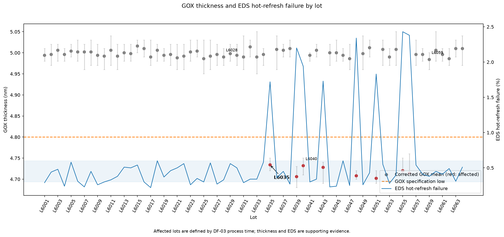
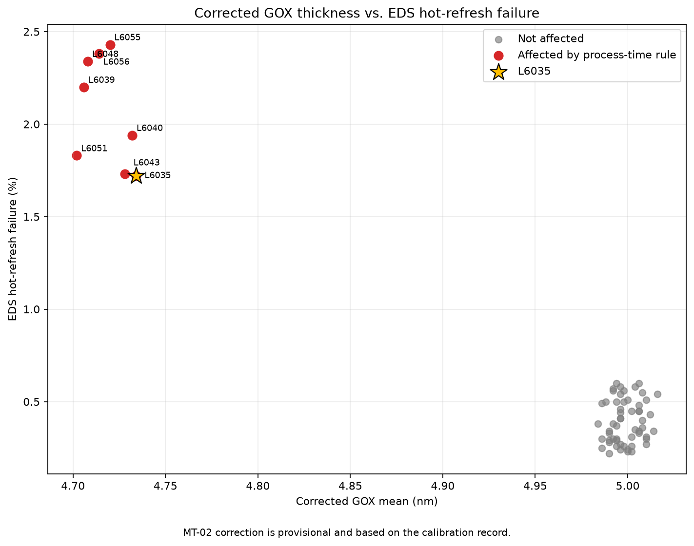

# 고객A 85°C 고온 리프레시 불량 사내 분석 보고서

- 고객A의 85°C·48시간 번인 데이터 손실은 회수품 L6039·L6048의 얇은 GOX와 일치하며, 확산 설비 온도 센서 이상에 따른 막 두께 저하가 잠정 원인이다.
- 공식 공정 기준으로 영향 범위는 8 lot·16,100개이며, 고객A 5 lot·10,200개, 고객B 2 lot·4,100개, 미출하 1 lot·1,800개다.
- 영향 8 lot의 EDS 고온 리프레시 불량률 평균은 2.071%로 비영향 56 lot 평균 0.393%보다 높아 공정 판정을 뒷받침한다.
- 사내 재고 출하 정지와 온도 센서 교체·측정기 재교정은 완료했으며, 고객A 보유 재고는 2026-11-04까지 전수 교체한다.
- 영향 구간 시작과 MT-02 −0.15 nm 보정은 각각 설비팀 정황 및 교정 기록에 따른 잠정 기준이며, 재측정 결과는 아직 없다.

## 1. 조사 목적과 결론 수준

고객A는 DDR5 RDIMM 일부가 85°C에서 48시간 번인되는 동안 데이터를 잃고, 같은 모듈을 25°C에서 다시 시험하면 정상이라고 신고했다. 고객 번인 불량률은 평소 약 0.3%에서 약 2%로 증가했으며, 신고된 고온 데이터 손실 lot은 L6039와 L6048이다 (`data/complaint_고객A.txt`).

본 조사의 목적은 고객 현상과 FA 결과를 팹의 공정·계측·EDS·출하 자료에 연결하여 원인과 영향 범위를 정하는 것이다. 영향 lot 자체는 담당자가 승인한 공정 이력 기준으로 확정한다. 원인은 FA와 데이터가 일관되지만 MT-02 재측정이 없으므로 **잠정 원인**으로 표현한다 (담당자 답변, 오세린 책임, 2026-10-30).

## 2. 사용 자료와 데이터 품질

분석에는 다음 자료를 사용했다.

| 자료 | 사용 목적 |
|---|---|
| `data/complaint_고객A.txt` | 고객 현상, 신고 lot, 요청 사항 확인 |
| `data/lot_history.csv` | lot별 확산 설비와 공정 투입 시각 역추적 |
| `data/metrology_gox.csv` | GOX 두께 원측정 및 잠정 보정 분석 |
| `data/eds_summary.csv` | EDS 수율과 고온 리프레시 불량률 비교 |
| `data/shipments.csv` | 고객, 출하일, 전체 모듈 수량 집계 |
| `data/equipment_log.txt` | 확산 설비 온도 센서 이상과 교체 이력 확인 |
| `data/calibration_log.txt` | MT-02 교정 이상과 보정 근거 확인 |
| `data/fa_note.txt` | 회수품 단면 분석과 고온 불량 메커니즘 확인 |

Phase 1 분석의 데이터 품질 검사 결과는 모두 통과했다 (`output/data_quality.csv`).

| 검사 항목 | 결과 |
|---|---:|
| 공정 이력 | 256행, 64 lot, lot당 4단계 |
| GOX 계측 | 320행, 64 lot, lot당 5 wafer |
| EDS | 64행, 64 lot |
| 출하 | 64행, 64 lot |
| 핵심 키 중복 | 0건 |
| 네 입력 파일 간 lot 누락 | 0건 |
| 공정 순서 오류 | 0건 |

`shipments.csv`의 `"2,000"`, `"2,100"` 표기는 쉼표를 제거한 정수로 정규화했다. 출하 수량은 담당자 확인에 따라 각 lot의 전체 모듈 수량이며 분할 출하는 없다 (담당자 답변, 오세린 책임, 2026-10-30).

## 3. 고객 현상과 FA 결과

FA에서는 고객 회수품 L6039와 L6048의 단면 GOX가 약 4.7 nm로 확인됐다. 정상품은 약 5.0 nm이며, 얇은 GOX로 인해 85°C에서 셀 누설 전류가 증가하고 리프레시 주기 안에 데이터를 유지하지 못한 것이 잠정 결론이다. 이는 고온에서만 데이터가 손실되고 상온 재시험에서는 정상인 고객 현상과 물리적으로 일치한다 (`data/fa_note.txt`).

L6020은 커넥터 부위의 낙하 충격 파손이며 칩 전기 특성과 GOX가 정상이다. 따라서 고온 리프레시 불량과 별개인 취급 파손 건으로 분리한다 (`data/fa_note.txt`).

## 4. 영향 범위 판정

### 4.1 공식 판정식

다음 세 조건을 모두 만족하면 영향 lot으로 판정했다.

1. 공정 단계가 `DIFF_GOX`이고,
2. 사용 설비가 `DF-03`이며,
3. 투입 시각이 **2026-10-10 08:00 이상, 2026-10-14 20:00 이하**다.

양 끝 시각은 포함한다. 이 시간 경계 중 시작 시각은 원자료에 직접 기록된 고장 발생 시점이 아니라, 10월 10일 08:00경부터 온도 알람 기준선이 비정상적으로 조용했다는 정황에 따라 설비팀이 정한 잠정 경계다. 종료 시각은 센서 교체와 온도 프로파일 재보정 완료 시각이다 (`data/equipment_log.txt`; 담당자 답변, 오세린 책임, 2026-10-30).

GOX 두께와 EDS 고온 리프레시 불량률은 영향 판정 조건으로 사용하지 않고, 위 공정 기준의 타당성을 확인하는 근거로만 사용했다.

### 4.2 MT-02 잠정 보정

MT-02는 2026-10-15 09:00 교정에서 5.00 nm 표준을 5.15 nm로 읽었고, −0.15 nm 오프셋 재교정 후 5.00 nm 합격이 확인됐다 (`data/calibration_log.txt`). 담당자 확인에 따라 2026-10-09 09:00 이상, 2026-10-15 09:00 미만의 MT-02 측정값에서 0.15 nm를 차감했다.

이 값은 재측정 결과가 아니므로 이하 보정값은 모두 **교정 기록 기준 보정, 잠정**이다. MT-01로 측정한 L6040에는 보정을 적용하지 않았다.

### 4.3 전체 영향 lot

공식 기준을 적용하면 영향 범위는 다음 8 lot, 16,100개다 (`output/affected_lots_internal.csv`).

| Lot | GOX 투입 시각 | 구분 | 출하일 | 수량 | 원평균 (nm) | 잠정 보정 평균 (nm) | 잠정 보정 범위 (nm) | EDS 고온 불량률 |
|---|---|---|---|---:|---:|---:|---:|---:|
| L6035 | 2026-10-10 23:00 | 고객A | 2026-10-17 | 2,000 | 4.884 | 4.734 | 4.72–4.75 | 1.72% |
| L6039 | 2026-10-11 15:00 | 고객A | 2026-10-18 | 2,100 | 4.856 | 4.706 | 4.68–4.73 | 2.20% |
| L6040 | 2026-10-11 18:00 | 미출하 | — | 1,800 | 4.732 | 4.732¹ | 4.71–4.75 | 1.94% |
| L6043 | 2026-10-12 07:00 | 고객B | 2026-10-19 | 2,200 | 4.878 | 4.728 | 4.69–4.74 | 1.73% |
| L6048 | 2026-10-13 04:00 | 고객A | 2026-10-20 | 1,800 | 4.858 | 4.708 | 4.70–4.72 | 2.34% |
| L6051 | 2026-10-13 15:00 | 고객A | 2026-10-20 | 2,100 | 4.852 | 4.702 | 4.69–4.72 | 1.83% |
| L6055 | 2026-10-14 07:00 | 고객B | 2026-10-21 | 1,900 | 4.870 | 4.720 | 4.69–4.75 | 2.43% |
| L6056 | 2026-10-14 11:00 | 고객A | 2026-10-21 | 2,200 | 4.864 | 4.714 | 4.68–4.76 | 2.38% |

¹ L6040은 MT-01 측정이므로 보정하지 않았다. 원측정 자체가 제품 규격 하한 4.8 nm보다 낮아 계측 불합격으로 홀드됐으며 미출하 상태다. 당시에는 단일 lot 이상으로 판단되어 범위 확대 조치가 이루어지지 않았다 (담당자 답변, 오세린 책임, 2026-10-30).

| 구분 | Lot 수 | 모듈 수량 | 처리 방향 |
|---|---:|---:|---|
| 고객A | 5 | 10,200 | 고객 보유/하위 고객 납품 상태 협의 및 전수 교체 |
| 고객B | 2 | 4,100 | 사내 영향 범위와 봉쇄에 포함 |
| 미출하 | 1 | 1,800 | L6040 출하 정지 |
| **전체** | **8** | **16,100** | — |

고객A가 현재 보유한 수량과 이미 하위 고객에게 납품한 수량은 확인되지 않았으므로 고객A와 협의가 필요하다. 위 수량은 출하 자료상 해당 lot의 전체 모듈 수량이다 (`data/shipments.csv`; 담당자 답변, 오세린 책임, 2026-10-30).

## 5. 공정 경계와 지표 비교

### 5.1 경계 lot

DF-03 투입 순서에서 영향 구간 직전 마지막 정상 lot은 L6028이고, 센서 교체 후 첫 정상 lot은 L6059다 (`output/df03_boundary_lots.csv`).

| 구분 | Lot | GOX 투입 시각 | 원평균 | 잠정 보정 평균 | 잠정 보정 범위 | EDS 고온 불량률 |
|---|---|---|---:|---:|---:|---:|
| 영향 구간 직전 | L6028 | 2026-10-09 18:00 | 5.140 nm | 4.990 nm | 4.97–5.01 nm | 0.33% |
| 교체 후 최초 | L6059 | 2026-10-15 00:00 | 5.134 nm | 4.984 nm | 4.96–5.00 nm | 0.38% |

두 경계 lot 모두 잠정 보정 후 GOX 평균이 약 4.99 nm이고 EDS 고온 리프레시 불량률도 평상 범위인 0.3~0.6% 안에 있다. 영향 구간 전후에 지표가 정상 수준이라는 점은 시간 기반 공정 경계와 정합한다.

### 5.2 영향·비영향 집단 비교

| 집단 | Lot 수 | EDS 고온 불량률 평균 | 관찰 범위 |
|---|---:|---:|---:|
| 영향 lot | 8 | 2.071% | 1.72–2.43% |
| 비영향 lot | 56 | 0.393% | 0.22–0.60% |

EDS 고온 리프레시 불량률에는 별도 출하 차단 기준이 없고 고객 번인과 동일한 지표도 아니다. 따라서 위 차이는 공정 기준을 대체하는 판정값이 아니라, 영향 lot에서 고온 취약성이 함께 증가했음을 보여주는 보조 근거다 (담당자 답변, 오세린 책임, 2026-10-30).

## 6. 그림과 해석

**그림 1.** 회색은 비영향 lot, 빨간색은 공식 공정 기준으로 판정한 영향 lot이다. 영향 8 lot에서 잠정 보정 GOX 평균이 규격 하한 4.8 nm 아래로 낮아지고 EDS 고온 리프레시 불량률이 동시에 상승한다. L6028과 L6059는 영향 구간 전후의 정상 수준을 보여준다. 파란 음영은 EDS 평상 범위 0.3~0.6%다.

**그림 2.** 영향 lot은 낮은 GOX 두께와 높은 EDS 고온 리프레시 불량률 영역에 분리되어 있다. L6035는 첫 공식 영향 lot으로, 원평균 4.884 nm였지만 MT-02 잠정 보정 후 4.734 nm이며 EDS 고온 불량률은 1.72%다. 이 그림은 상관 패턴을 보여주지만 영향 판정 자체는 공정 설비·시간 기준을 따른다.

## 7. 원인 판단 과정

### 7.1 잠정 원인

현재 증거를 종합하면 **DF-03 온도 센서가 실제보다 높은 온도를 표시해 제어기가 충분히 가열하지 않았고, 그 결과 GOX가 얇게 형성되어 고온 셀 누설과 리프레시 실패가 증가한 것**이 잠정 원인이다.

근거 연결은 다음과 같다.

1. 설비 이력: DF-03의 기존 존3 열전대가 실제보다 높게 읽어 제어기가 덜 가열한 것으로 확인됐고, 2026-10-14 20:00 교체 후 온도 프로파일을 재보정했다 (`data/equipment_log.txt`).
2. 공정 집중: 고온 불량이 높은 8 lot이 모두 승인된 DF-03 이상 시간 구간에 집중된다 (`data/lot_history.csv`, `output/affected_lots_internal.csv`).
3. 계측 정합성: 영향 8 lot의 잠정 보정 GOX 평균은 4.702~4.734 nm이며 모두 규격 하한 4.8 nm보다 낮다. MT-01로 측정한 L6040도 4.732 nm로 낮아 MT-02 편향만으로 현상을 설명할 수 없다 (`data/metrology_gox.csv`).
4. 전기적 정합성: 영향 집단의 EDS 고온 리프레시 불량률 평균 2.071%는 비영향 집단 0.393%보다 높다 (`data/eds_summary.csv`, `output/core_summary.json`).
5. FA 정합성: 고객 회수품 L6039·L6048의 단면 GOX 약 4.7 nm와 고온 누설 메커니즘이 팹 데이터와 일치한다 (`data/fa_note.txt`).
6. 경계 정합성: 이상 구간 직전 L6028과 교체 후 L6059는 잠정 보정 GOX 약 4.99 nm, EDS 0.33%·0.38%로 정상 수준이다 (`output/df03_boundary_lots.csv`).

### 7.2 대안 설명 검토

| 대안 설명 | 검토 결과 |
|---|---|
| MT-02 측정 편향만의 문제 | 배제 방향. MT-01 측정 L6040도 GOX가 낮고 EDS 고온 불량률이 높다. 다만 MT-02 보정값은 재측정 전까지 잠정이다. |
| 특정 EDS 시험기 문제 | 지지되지 않음. 영향 lot은 T02·T03·T04 여러 EDS 시험기에 걸쳐 있어 단일 시험기 집중이 아니다 (`data/lot_history.csv`). |
| 고객 모듈 또는 상온 동작의 일반 불량 | 지지되지 않음. 고객 현상은 고온에서 발생하고 상온 재시험은 정상이며, 회수품 FA가 얇은 GOX와 고온 누설을 확인했다. |
| L6020과 동일 원인 | 배제. L6020은 낙하 충격에 따른 커넥터 파손이고 칩 특성은 정상이다. |

## 8. 봉쇄·시정·재발 방지

| 구분 | 조치 | 상태/기한 |
|---|---|---|
| 봉쇄 | 고객A 보유 재고 전수 교체 | 2026-11-04까지 |
| 봉쇄 | L6040을 포함한 사내 재고 출하 정지 | 완료 |
| 시정 | 확산 설비 온도 센서 교체 및 온도 프로파일 재보정 | 2026-10-14 완료 |
| 시정 | 두께 측정기 재교정 | 2026-10-15 완료 |
| 재발 방지 | 측정기 교정 주기를 월 1회에서 주 1회로 변경 | 2026-11-01 시작 |
| 재발 방지 | 확산로 온도 센서 이중화 | 2026-11-15까지 |

고객B 출하분도 사내 영향 범위와 봉쇄 대상에 포함한다. 고객A 보유 또는 하위 고객 납품 수량은 고객A와 협의하여 확인해야 한다 (담당자 답변, 오세린 책임, 2026-10-30).

## 9. 한계와 후속 확인

- 영향 구간 시작인 2026-10-10 08:00은 설비 데이터에 직접 기록된 고장 발생 시각이 아니라 온도 알람 정황에 근거한 잠정 경계다.
- MT-02 −0.15 nm 보정은 교정 기록에 따른 잠정 보정이며, 영향 lot의 보관 wafer 재측정 결과는 아직 없다.
- 원인과 메커니즘은 설비 이력, 계측, EDS 및 FA가 일관되게 지지하지만, 위 두 잠정 요소 때문에 최종 대외 표현은 잠정 원인으로 유지한다.
- 고객A의 실제 보유량과 하위 고객 납품량은 현재 자료로 알 수 없으므로 전수 교체 범위 확정을 위해 고객A와 협의해야 한다.
- 후속 확인 시 MT-02 재측정 결과와 고객A 재고·납품 현황을 본 보고서에 갱신하고, 확정 전까지 현재의 보수적 8 lot 범위를 유지한다.
